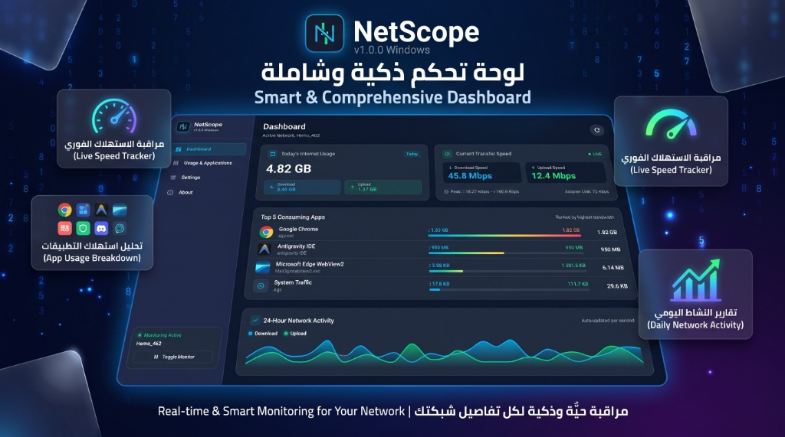
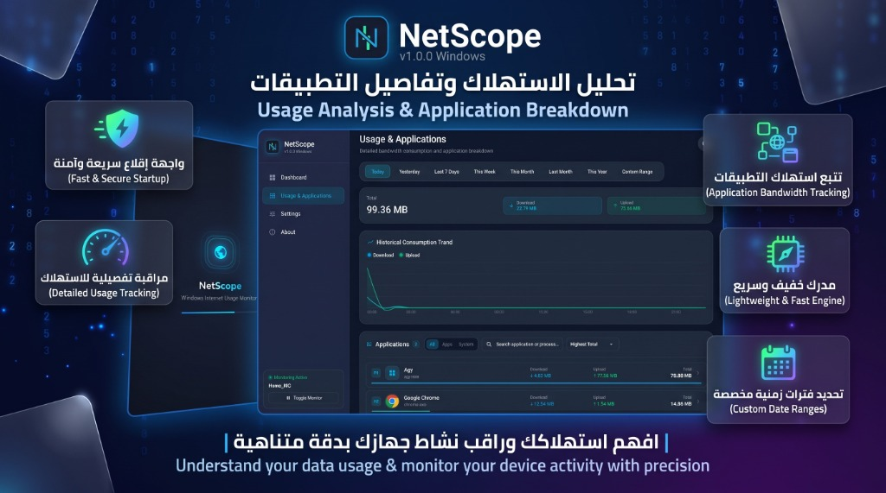
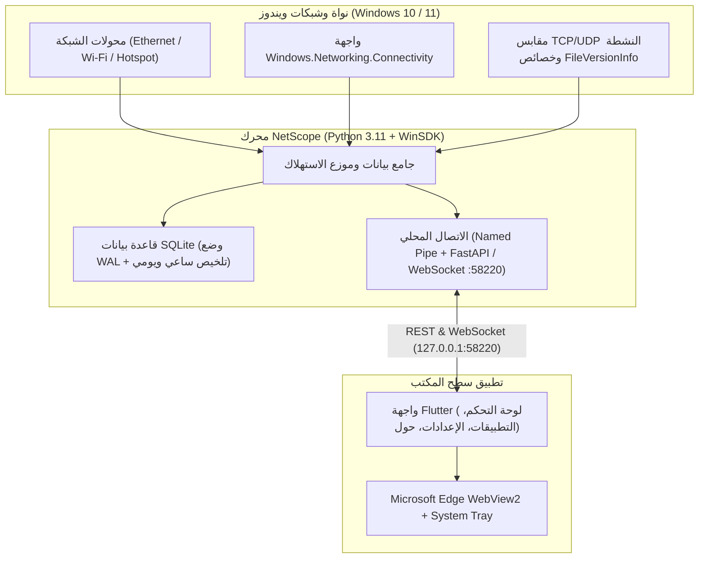

<div align="center">


# NetScope

### مراقب سرعة الإنترنت واستهلاك التطبيقات الفوري لنظام ويندوز

*أداة سطح مكتب عصرية مستوحاة من GlassWire، مبنية على واجهات نظام ويندوز الأصلية (Windows Kernel & Connectivity APIs) — بيانات حقيقية 100% بدون أي محاكاة.*

[-0078D6?style=flat-square&logo=windows)](https://github.com/ENG-Ebraheem/NetScope)
[-02569B?style=flat-square&logo=flutter)](https://flutter.dev)
[](https://www.python.org)
[-003B57?style=flat-square&logo=sqlite)](https://sqlite.org)
[](#المميزات-الرئيسية)
[](LICENSE)

🌐 **[English](README.md)** · **العربية (أنت هنا)**

[نظرة عامة](#نظرة-عامة) · [لقطات الشاشة](#لقطات-الشاشة) · [المميزات](#المميزات-الرئيسية) · [المتطلبات](#المتطلبات) · [التثبيت السريع](#التثبيت-والتشغيل-السريع) · [التشغيل من المصدر](#التشغيل-من-الكود-المصدري-للمطورين) · [المعمارية](#المعمارية-والتقنيات) · [المطور](#المطور-والتواصل)

</div>

---

## نظرة عامة

<div dir="rtl">

تطبيق **NetScope (نت سكوب)** هو برنامج سطح مكتب خفيف لنظام **Windows** يمنحك رؤية كاملة ودقيقة لسرعة الإنترنت الحية، وإجمالي استهلاكك اليومي والشهري، وحجم البيانات التي يستهلكها كل برنامج أو خدمة نظام في جهازك على حدة.

على عكس عدادات الشبكة البسيطة، يدمج NetScope بين قراءة محولات الشبكة الفيزيائية (`psutil.net_io_counters`) وواجهة الاتصال الأصلية في ويندوز (`Windows.Networking.Connectivity`) وتتبع مقابس الشبكة النشطة (`TCP/UDP Sockets`)، ثم يخزّن البيانات في قاعدة بيانات **SQLite (وضع WAL)** سريعة جداً، ويعرضها عبر واجهة **Flutter** عصرية تعمل داخل **Microsoft Edge WebView2**.

</div>

---

## لقطات الشاشة

<div align="center">

### لوحة تحكم ذكية وشاملة (Dashboard)
*تعرض سرعة التحميل والرفع الفورية، ملخص استهلاك اليوم، أكثر 5 تطبيقات استهلاكاً، والرسم البياني للنشاط خلال 24 ساعة.*



<br />

### تحليل الاستهلاك وتفاصيل التطبيقات (Usage & Applications)
*منحنى الاستهلاك التاريخي، فلاتر الفترات الزمنية، البحث والترتيب، وفحص الاتصالات النشطة لكل تطبيق.*



</div>

---

## المميزات الرئيسية

<div dir="rtl">

### 1. مراقبة فورية ودقيقة 100% بدون محاكاة
* **قياس مباشر من نواة ويندوز:** يقرأ عدادات الشبكة الحية (`psutil.net_io_counters`)، وواجهة `winsdk.windows.networking.connectivity`، ويحوّل مسارات النواة (`QueryDosDeviceW`) إلى مسارات أقراص ويندوز، مع تتبع الاتصالات النشطة (`psutil.net_connections`).
* **التعرف الذكي على البرامج:** يقرأ اسم البرنامج من خصائص الملف (`FileVersionInfo`)، ويستخرج أيقونات البرامج بدقة `32x32` (`ExtractIconEx`) مع تخزينها مؤقتاً، ويصنّف الحركة إلى **تطبيقات (Apps)** أو **خدمات النظام (System)** أو **غير منسوبة (Unattributed)**.
* **قراءة واضحة للسرعة:** يعرض سرعة التنزيل والرفع المباشرة (`Mbps` و`Kbps` و`bps`)، وأعلى سرعة في الجلسة، وسرعة ربط المحوّل.

### 2. واجهة عصرية تدعم العربية والإنجليزية
* **لوحة التحكم (Dashboard):** نظرة سريعة تضم استهلاك اليوم، وسرعة النقل الحالية، وقائمة **أكثر 5 تطبيقات استهلاكاً**، ومخطط النشاط على مدار **24 ساعة**.
* **الاستهلاك والتطبيقات (Usage & Applications):** استعراض البيانات حسب `اليوم`، `الأمس`، `آخر 7 أيام`، `هذا الأسبوع`، `هذا الشهر`، `الشهر الماضي`، `هذه السنة`، أو **فترة زمنية مخصصة**، مع الفلترة والبحث والترتيب، ونافذة تفاصيل تعرض المسار التنفيذي والاتصالات الحية لكل تطبيق.
* **3 أوضاع للمظهر:** التبديل بسلاسة بين الوضع **الداكن (Dark)**، و**الفاتح (Light)**، و**التلقائي (System)** ليتبع ثيم ويندوز تلقائياً.
* **ثنائي اللغة بالكامل:** دعم أصيل للغتين **العربية (RTL)** و**الإنجليزية (LTR)** في جميع الشاشات والجداول والتنبيهات.

### 3. خدمة خلفية 24/7 وشريط النظام والتنبيهات
* **محرك مراقبة مستقل (`NetScopeService`):** يستمر في تسجيل الاستهلاك على مدار الساعة حتى عند إغلاق النافذة وتصغيرها إلى شريط النظام (`System Tray`).
* **تكامل كامل مع ويندوز:** زر واحد لتفعيل **التشغيل مع ويندوز** (عبر سجل النظام ومجلد بدء التشغيل)، مع إمكانية التثبيت الاختياري كخدمة نظام أصلية عبر [`install_service.bat`](install_service.bat).
* **تنبيهات مخصصة:** ضبط حد تنبيه يومي أو شهري بالـ MB، وتنبيه عند اتصال أي تطبيق جديد بالشبكة لأول مرة.
* **خصوصية تامة 100%:** جميع البيانات محفوظة محلياً على جهازك فقط في SQLite؛ بدون أي رفع سحابي، أو تتبع خارجي، أو قراءة لمحتوى الحزم.

</div>

---

## المتطلبات

<div dir="rtl">

### أولاً: للمستخدم العادي (تشغيل برنامج التثبيت مباشرة)
> هذا هو الخيار الموصى به إذا كنت تريد استخدام البرنامج فقط دون الحاجة لأدوات برمجة.

</div>

| المتطلب | المواصفة المطلوبة | ملاحظات |
|---|---|---|
| **نظام التشغيل** | Windows 10 (بناء 1809+) أو Windows 11 | نواة 64-بت (`x64`) |
| **بيئة العرض** | Microsoft Edge WebView2 Runtime | مثبت افتراضياً في Windows 11 وإصدارات Windows 10 الحديثة ([التحميل عند الحاجة](https://developer.microsoft.com/en-us/microsoft-edge/webview2/)) |
| **الذاكرة (RAM)** | قرابة `200 MB` متاحة | استهلاك خفيف (~72 MB للخدمة الخلفية، ~109 MB عند فتح الواجهة) |
| **مساحة القرص** | قرابة `150 MB` فارغة | تشمل قاعدة البيانات المحلية والأيقونات |
| **الصلاحيات** | مستخدم عادي (Standard User) | صلاحيات المسؤول تُطلب فقط إذا أردت التثبيت كخدمة عبر `install_service.bat` |

<div dir="rtl">

### ثانياً: للمطورين (التشغيل أو البناء من الكود المصدري)

</div>

| الأداة | الإصدار المطلوب | الغرض |
|---|---|---|
| **Python** | `3.11+` (مُختبر على `3.11.0`) | تشغيل محرك المراقبة الخلفي وواجهات Win32/WinSDK وخادم FastAPI وWebView2 |
| **Flutter SDK** | Dart `^3.6.1` (Flutter `3.27+`) | بناء واجهة الويب المدمجة (`app/build/web`) |
| **Git** | أي إصدار حديث | استنساخ المستودع من GitHub |
| **PyInstaller** *(اختياري)* | `6.x` | تجميع الملفات التنفيذية ومُثبّت ويندوز (`NetScope Setup.exe`) |

---

## التثبيت والتشغيل السريع

<div dir="rtl">

### الخيار الأول: مُثبّت ويندوز (`NetScope Setup.exe`) — الموصى به
1. انتقل إلى صفحة [**الإصدارات (Releases)**](https://github.com/ENG-Ebraheem/NetScope/releases) وحمّل ملف **`NetScope Setup.exe`**.
2. شغّل **`NetScope Setup.exe`** واتبع خطوات معالج التثبيت:
   * اختيار مجلد التثبيت (الافتراضي: `%LOCALAPPDATA%\Programs\NetScope`).
   * اختيار إنشاء اختصارات سطح المكتب وقائمة ابدأ، وتفعيل التشغيل التلقائي مع ويندوز.
3. شغّل **NetScope** من سطح المكتب أو قائمة ابدأ.

> **دعم التثبيت الصامت (Silent Install):**
> ```powershell
> "NetScope Setup.exe" /S --dir="C:\Tools\NetScope"
> ```

</div>

---

## التشغيل من الكود المصدري (للمطورين)

<div dir="rtl">

بما أن مخرجات البناء (`app/build/` و`dist/` و`*.exe`) مستبعدة من Git، يجب بناء أصول واجهة Flutter **مرة واحدة** قبل تشغيل محرك Python.

### 1. استنساخ المستودع
```powershell
git clone https://github.com/ENG-Ebraheem/NetScope.git
cd NetScope
```

### 2. بناء واجهة Flutter Web
```powershell
cd app
flutter pub get
flutter build web --release --pwa-strategy=none
cd ..
```

### 3. تثبيت مكتبات Python
```powershell
python -m venv .venv
.\.venv\Scripts\Activate.ps1
pip install -r monitor_engine/requirements.txt
```

### 4. تشغيل البرنامج
```powershell
# تشغيل التطبيق بالواجهة الكاملة + الخدمة الخلفية + أيقونة شريط النظام
python monitor_engine/main.py

# أو تشغيل محرك المراقبة في الخلفية بدون واجهة
python monitor_engine/service_main.py
```

</div>

---

## بناء النسخة التنفيذية والمُثبّت

```powershell
# تأكد من بناء واجهة Flutter أولاً داخل (app/build/web)
pip install pyinstaller

# 1. بناء NetScope.exe و NetScopeService.exe داخل dist/NetScope/
python -m PyInstaller NetScope.spec --noconfirm

# 2. ضغط الملفات وبناء معالج التثبيت NetScope Setup.exe داخل installer/dist/
Compress-Archive -Path "dist\NetScope\*" -DestinationPath "installer\netscope_dist.zip" -Force
python -m PyInstaller installer/installer.spec --noconfirm --distpath installer/dist --workpath installer/build
```

---

## خيارات سطر الأوامر (`CLI`) وخدمة ويندوز

يدعم `NetScope.exe` (و`python monitor_engine/main.py`) الخيارات التالية:

| الخيار (Flag) | الوظيفة |
|---|---|
| *(بدون خيارات)* | تشغيل التطبيق بالواجهة الكاملة وأيقونة شريط النظام والمراقبة الخلفية |
| `--minimized` | البدء مصغّراً بصمت في شريط النظام (`System Tray`) |
| `--show` | إجبار إظهار النافذة الرئيسية حتى لو كان وضع البدء المصغّر مفعلاً |
| `--background` | التشغيل في الخلفية بدون إنشاء نافذة واجهة |
| `--test` | إجراء اختبار فوري للقياس الحقيقي لمدة 5 ثوانٍ وعرض النتائج |
| `--enable-startup` | تسجيل NetScope ليعمل تلقائياً عند تسجيل الدخول لويندوز |
| `--disable-startup` | إزالة NetScope من برامج بدء التشغيل التلقائي |
| `--clear-db` | مسح سجل استهلاك الشبكة المخزن في قاعدة البيانات |

<div dir="rtl">

### اختياري: التسجيل كخدمة نظام أصلية (`services.msc`)
شغّل الملف [`install_service.bat`](install_service.bat) **كمسؤول (Run as Administrator)** لتثبيت `NetScopeService.exe` ضمن خدمات ويندوز، واستخدم [`uninstall_service.bat`](uninstall_service.bat) لإزالتها بشكل نظيف.

</div>

---

## تشغيل الاختبارات

```powershell
# اختبارات بايثون للمحرك وقاعدة البيانات والـ API (8 اختبارات)
python -B -m unittest discover -s monitor_engine/tests -v

# فحص الكود واختبارات واجهة Flutter
cd app
flutter analyze
flutter test
```

---

## المعمارية والتقنيات



<div dir="rtl">

للمزيد من التفاصيل التقنية (باللغة الإنجليزية):
* [`docs/ARCHITECTURE.md`](docs/ARCHITECTURE.md) — استراتيجية القياس متعدد الطبقات وهيكل قاعدة البيانات وبروتوكول الـ IPC.
* [`docs/INSTALLATION.md`](docs/INSTALLATION.md) — دليل التثبيت والإعداد والإزالة الكاملة.
* [`docs/USER_GUIDE.md`](docs/USER_GUIDE.md) — شرح كل شاشة وميزة داخل البرنامج.

</div>

---

## هيكل المشروع

```text
NetScope/
├── app/                         # الكود المصدري لواجهة Flutter Web
│   ├── assets/                  # أيقونة وهوية التطبيق
│   ├── lib/
│   │   ├── core/                # الألوان، الثيم الداكن/الفاتح، الترجمة (AR/EN)
│   │   ├── features/            # الشاشات (Dashboard, Applications, Settings, About)
│   │   ├── models/              # نماذج البيانات والإعدادات
│   │   ├── services/            # خدمات الاتصال REST وWebSocket والتخزين
│   │   └── shared/              # البطاقات الزجاجية، الرسوم البيانية، القائمة الجانبية
│   ├── test/                    # اختبارات واجهة Flutter
│   └── pubspec.yaml             # اعتماديات Flutter وإعدادات الأصول
├── monitor_engine/              # محرك المراقبة الخلفي بلغة Python 3.11
│   ├── src/
│   │   ├── monitor.py           # قراءة الشبكة، ربط المقابس، التنبيهات والأيقونات
│   │   ├── database.py          # إدارة SQLite WAL والتجميع الساعي واليومي
│   │   ├── ipc_server.py        # خادم FastAPI وWebSocket وNamed Pipe
│   │   └── service.py           # قفل التكرار (Mutex)، بدء التشغيل وخدمة ويندوز
│   ├── tests/                   # اختبارات المحرك والـ API
│   ├── main.py                  # نقطة تشغيل الواجهة (PyWebView + System Tray)
│   ├── service_main.py          # نقطة تشغيل الخدمة الخلفية المستقلة
│   └── requirements.txt         # مكتبات Python المطلوبة
├── installer/                   # معالج التثبيت (Tkinter + PyInstaller spec)
├── docs/                        # الوثائق التقنية ولقطات الشاشة
├── generate_icons.py            # سكربت توليد الأيقونات بمقاسات متعددة
├── NetScope.spec                # ملف بناء NetScope.exe و NetScopeService.exe
├── install_service.bat          # سكربت تثبيت خدمة ويندوز
├── uninstall_service.bat        # سكربت إزالة خدمة ويندوز
├── LICENSE                      # رخصة MIT
├── README.md                    # الوثائق باللغة الإنجليزية
└── README.ar.md                 # الوثائق الكاملة باللغة العربية
```

---

## الأمان والخصوصية

<div dir="rtl">

* **بيانات محلية 100%:** كل الإحصائيات وسجلات التطبيقات تُحفظ داخل قاعدة بيانات SQLite الخاصة بك على جهازك فقط.
* **بدون أي تتبع خارجي:** لا يرسل NetScope أي بيانات استخدام أو إحصائيات إلى أي خادم خارجي.
* **بدون فحص محتوى الحزم (No DPI):** يفحص البرنامج عدادات البايتات وعناوين المقابس فقط ولا يقرأ محتوى اتصالاتك أبداً.

</div>

---

## المطور والتواصل

تم تطوير هذا المشروع بواسطة **إبراهيم أحمد المقبلي (Ebrahim Ahmed Al-Moqbily)**

[](https://github.com/ENG-Ebraheem)
[](https://wa.me/HeMo_dev)

---

## الرخصة

البرنامج مفتوح المصدر ومتاح بموجب [رخصة MIT](LICENSE).
