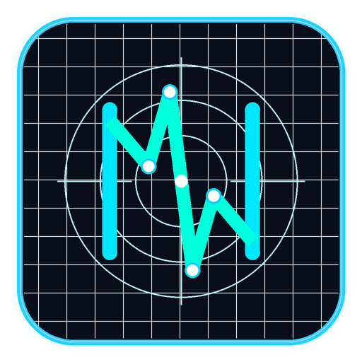
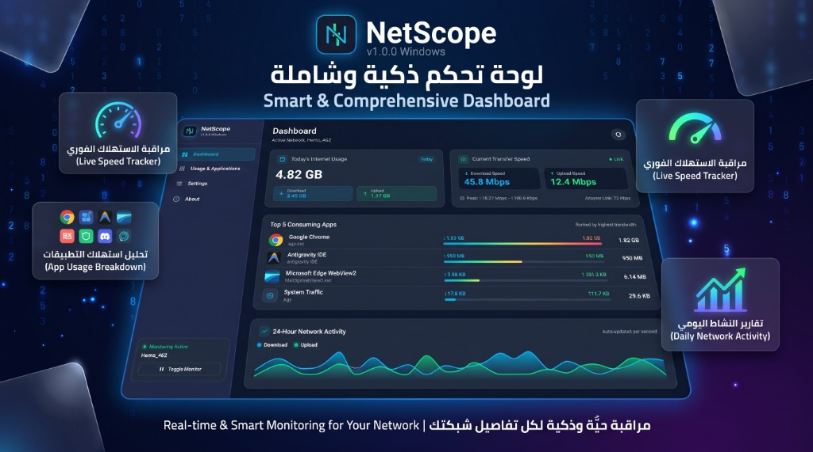
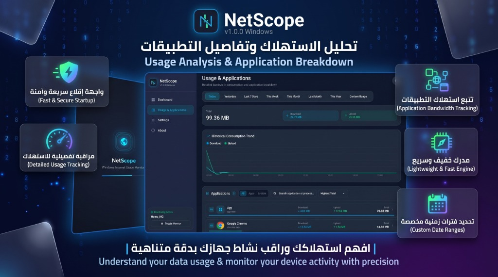
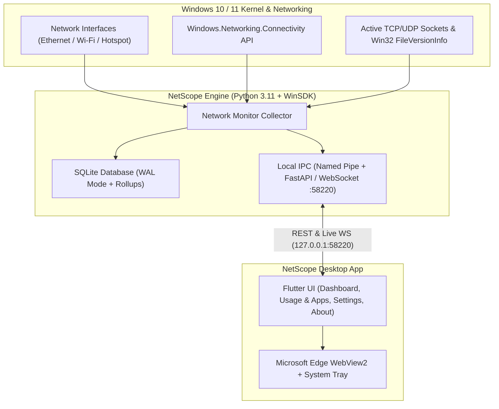

<div align="center">



# NetScope

### Real-Time Windows Internet Speed Monitor & Per-Application Bandwidth Tracker

*A GlassWire-inspired Windows desktop telemetry tool powered by native Windows Kernel & Connectivity APIs — 100% real data, zero simulation.*

[-0078D6?style=flat-square&logo=windows)](https://github.com/ENG-Ebraheem/NetScope)
[-02569B?style=flat-square&logo=flutter)](https://flutter.dev)
[](https://www.python.org)
[-003B57?style=flat-square&logo=sqlite)](https://sqlite.org)
[](#key-features)
[](LICENSE)

[Overview](#overview) · [Screenshots](#screenshots) · [Features](#key-features) · [Requirements](#requirements) · [Quick Start](#installation--quick-start) · [Run from Source](#running-from-source-developers) · [Architecture](#architecture) · [Developer](#developer--contact)

</div>

---

## Overview

**NetScope** is a lightweight Windows desktop application built to give you complete visibility into your live internet speed, daily and monthly bandwidth usage, and exact consumption per application or Windows system process.

Unlike basic interface counters, NetScope combines physical network adapter telemetry (`psutil.net_io_counters`), `Windows.Networking.Connectivity`, and live TCP/UDP socket attribution into an ultra-fast SQLite WAL database, presented through a modern **Flutter** interface embedded in **Microsoft Edge WebView2**.

<details>
<summary><b>نبذة سريعة باللغة العربية (اضغط للفتح)</b></summary>

<div dir="rtl">

**NetScope (نت سكوب)** هو تطبيق سطح مكتب متكامل لنظام **Windows 10 / 11** لمراقبة سرعة الإنترنت الفورية وتحليل استهلاك البيانات لكل برنامج وخدمة في جهازك بدقة حقيقية **100% بدون أي بيانات وهمية**.

- **متابعة فورية:** يعرض سرعة التحميل والرفع الحية، إجمالي استهلاك اليوم والشهر، وأكثر 5 تطبيقات استهلاكاً مع رسم بياني تفاعلي على مدار 24 ساعة.
- **تحليل شامل للتطبيقات:** استعراض الاستهلاك حسب اليوم، الأمس، آخر 7 أيام، الأسبوع، الشهر، السنة، أو فترة مخصصة، مع فحص الاتصالات النشطة (`TCP/UDP`) ومسار الملف التنفيذي لكل تطبيق.
- **خفيف ويعمل في الخلفية:** خدمة مراقبة مستقلة (`NetScopeService`) تعمل في شريط النظام (`System Tray`) مع تنبيهات الحصص اليومية/الشهرية والتطبيقات الجديدة.
- **يدعم العربية والإنجليزية:** واجهة عصرية تدعم الاتجاهين (`RTL / LTR`) مع 3 أوضاع للمظهر (**داكن**، **فاتح**، و**تلقائي حسب النظام**).

</div>

</details>

---

## Screenshots

<div align="center">

### Smart & Comprehensive Dashboard
*Live download/upload speeds, today's total breakdown, Top 5 consuming apps, and 24-hour network activity chart.*



<br />

### Usage Analysis & Application Breakdown
*Historical consumption trends, timeframe filters, search/sorting, and per-application socket inspection.*



</div>

---

## Key Features

### 1. Real-Time Telemetry & Attribution
- **Zero-Simulation Kernel Metrics**: Reads live adapter counters (`psutil.net_io_counters`), `winsdk.windows.networking.connectivity`, NT-to-DOS volume paths (`QueryDosDeviceW`), and active TCP/UDP sockets (`psutil.net_connections`).
- **Smart App Resolution**: Automatically reads Windows `FileVersionInfo` product names, extracts & caches `32x32` application icons (`ExtractIconEx`), and classifies traffic into **Apps**, **System**, or **Unattributed**.
- **Human-Friendly Speeds**: Displays real-time download/upload throughput (`Mbps`, `Kbps`, `bps`), session peaks, and active adapter link speed.

### 2. Modern Bilingual Desktop Interface
- **Dashboard**: Clean overview featuring Today's Usage, Current Transfer Speed, **Top 5 Consuming Apps**, and an interactive **24-Hour Network Activity** chart.
- **Usage & Applications**: Filter bandwidth across `Today`, `Yesterday`, `Last 7 Days`, `This Week`, `This Month`, `Last Month`, `This Year`, or a **Custom Date Range**, sort by Total / Download / Upload / Name, and inspect any app's live remote endpoints and executable path.
- **3 Theme Modes**: Switch seamlessly between **Dark**, **Light**, and **System** (automatically matches Windows Dark/Light mode).
- **Arabic & English (`RTL` / `LTR`)**: Full bilingual localization across every screen, chart, and dialog.

### 3. Background Service, System Tray & Alerts
- **Independent Background Engine**: `NetScopeService` continues capturing traffic 24/7 even when the UI window is closed to the System Tray (`pystray`).
- **Windows Integration**: One-click toggle for **Start with Windows** (`HKCU\Software\Microsoft\Windows\CurrentVersion\Run` + Startup shortcut) and optional native Windows Service installation via [`install_service.bat`](install_service.bat).
- **Custom Alerts**: Configurable daily/monthly quota alerts (in MB) and first-seen new application network alerts.
- **100% Local & Private**: All metrics stay on your machine inside SQLite (WAL mode). No cloud uploads, no telemetry, and no packet payload inspection.

---

## Requirements

### For End Users (Using the Windows Installer)
> Recommended if you just want to install and run NetScope without developer tools.

| Requirement | Specification | Notes |
|---|---|---|
| **Operating System** | Windows 10 (Build 1809+) or Windows 11 | 64-bit (`x64`) |
| **WebView Runtime** | Microsoft Edge WebView2 Runtime | Pre-installed on Windows 11 & updated Windows 10 ([Download here if missing](https://developer.microsoft.com/en-us/microsoft-edge/webview2/)) |
| **Memory (RAM)** | ~200 MB free | Lightweight footprint (~72 MB service, ~109 MB UI when open) |
| **Disk Space** | ~150 MB free | Includes local SQLite history & icon cache |
| **Permissions** | Standard User | Administrator privileges are only needed if registering via `install_service.bat` |

### For Developers (Running or Building from Source)
| Tool | Version | Purpose |
|---|---|---|
| **Python** | `3.11+` (`3.11.0` tested) | Backend monitoring engine, Win32/WinSDK telemetry, FastAPI IPC, WebView2 host |
| **Flutter SDK** | Dart `^3.6.1` (Flutter `3.27+`) | Building the frontend web bundle (`app/build/web`) |
| **Git** | Any recent version | Cloning the repository |
| **PyInstaller** *(optional)* | `6.x` | Packaging standalone binaries (`NetScope.exe`, `NetScopeService.exe`, `NetScope Setup.exe`) |

---

## Installation & Quick Start

### Option A: Windows Installer (`NetScope Setup.exe`) — Recommended
1. Go to the [**GitHub Releases**](https://github.com/ENG-Ebraheem/NetScope/releases) page and download **`NetScope Setup.exe`**.
2. Double-click **`NetScope Setup.exe`** and follow the setup wizard:
   - Choose the installation directory (default: `%LOCALAPPDATA%\Programs\NetScope`).
   - Optionally create Desktop / Start Menu shortcuts and enable **Start with Windows**.
3. Launch **NetScope** from the Desktop or Start Menu.

> **Silent Install Support:**
> ```powershell
> "NetScope Setup.exe" /S --dir="C:\Tools\NetScope"
> ```

---

## Running from Source (Developers)

Because compiled build outputs (`app/build/`, `dist/`, `*.exe`) are excluded from version control, you must build the Flutter web assets **once** before starting the Python engine.

### 1. Clone the Repository
```powershell
git clone https://github.com/ENG-Ebraheem/NetScope.git
cd NetScope
```

### 2. Build the Flutter UI Assets
```powershell
cd app
flutter pub get
flutter build web --release --pwa-strategy=none
cd ..
```

### 3. Install Python Dependencies
```powershell
python -m venv .venv
.\.venv\Scripts\Activate.ps1
pip install -r monitor_engine/requirements.txt
```

### 4. Run NetScope
```powershell
# Launch desktop UI + background engine + System Tray
python monitor_engine/main.py

# Or launch the background monitoring engine headless
python monitor_engine/service_main.py
```

---

## Building the Standalone Package & Installer

```powershell
# Ensure Flutter web assets are built first (app/build/web)
pip install pyinstaller

# 1. Build NetScope.exe & NetScopeService.exe -> dist/NetScope/
python -m PyInstaller NetScope.spec --noconfirm

# 2. Bundle distribution for the Setup Wizard & build NetScope Setup.exe -> installer/dist/
Compress-Archive -Path "dist\NetScope\*" -DestinationPath "installer\netscope_dist.zip" -Force
python -m PyInstaller installer/installer.spec --noconfirm --distpath installer/dist --workpath installer/build
```

---

## CLI Options & Windows Service

`NetScope.exe` (and `python monitor_engine/main.py`) supports the following flags:

| Flag | Description |
|---|---|
| *(none)* | Launches the full desktop window, System Tray icon, and background monitor |
| `--minimized` | Starts silently minimized in the Windows System Tray |
| `--show` | Forces showing the main window even if *Launch Minimized* is enabled |
| `--background` | Runs headless in the background without creating a GUI window |
| `--test` | Runs a 5-second live attribution diagnostic test and prints status |
| `--enable-startup` | Registers NetScope to start automatically on Windows login |
| `--disable-startup` | Removes NetScope from Windows login startup |
| `--clear-db` | Clears stored bandwidth usage history |

### Optional: Register as a Native Windows Service (`services.msc`)
Run [`install_service.bat`](install_service.bat) **as Administrator** to register `NetScopeService.exe` as a Windows system service. Use [`uninstall_service.bat`](uninstall_service.bat) to remove it cleanly.

---

## Running Tests

```powershell
# Backend Python unit & FastAPI ASGI tests (8 tests)
python -B -m unittest discover -s monitor_engine/tests -v

# Frontend Flutter static analysis & widget tests
cd app
flutter analyze
flutter test
```

---

## Architecture



For deeper technical documentation, see:
- [`docs/ARCHITECTURE.md`](docs/ARCHITECTURE.md) — Multi-layer Windows attribution, database schema, and IPC specification.
- [`docs/INSTALLATION.md`](docs/INSTALLATION.md) — Detailed installation, startup configuration, and uninstallation guide.
- [`docs/USER_GUIDE.md`](docs/USER_GUIDE.md) — Screen-by-screen walkthrough of every feature.

---

## Project Structure

```text
NetScope/
├── app/                         # Flutter Desktop Web Frontend
│   ├── assets/                  # App branding icon
│   ├── lib/
│   │   ├── core/                # App colors, dark/light themes, AR/EN localizations
│   │   ├── features/            # Dashboard, Usage & Applications, Settings, About
│   │   ├── models/              # Strongly-typed telemetry & settings models
│   │   ├── services/            # REST API, WebSocket & storage services
│   │   └── shared/              # Reusable glass cards, charts, sidebar & avatars
│   ├── test/                    # Flutter widget & localization tests
│   └── pubspec.yaml             # Flutter dependencies & assets config
├── monitor_engine/              # Python 3.11 Windows Monitoring Engine
│   ├── src/
│   │   ├── monitor.py           # Traffic collector, socket mapper, alerts & icon cache
│   │   ├── database.py          # SQLite WAL manager & hourly/daily rollups
│   │   ├── ipc_server.py        # FastAPI REST, WebSocket & Windows Named Pipe server
│   │   └── service.py           # Singleton mutex, startup registry & Windows service
│   ├── tests/                   # Backend unit & API tests
│   ├── main.py                  # Desktop GUI (PyWebView + System Tray) entry point
│   ├── service_main.py          # Headless background daemon / service entry point
│   └── requirements.txt         # Python package requirements
├── installer/                   # Windows Setup Wizard (Tkinter + PyInstaller spec)
├── docs/                        # Architecture, installation, user guide & screenshots
├── generate_icons.py            # Multi-resolution brand icon generator
├── NetScope.spec                # PyInstaller spec for NetScope.exe & NetScopeService.exe
├── install_service.bat          # Native Windows Service installer
├── uninstall_service.bat        # Native Windows Service uninstaller
└── LICENSE                      # MIT License
```

---

## Security & Privacy

- **100% Local Data**: Every metric and app record stays inside your local SQLite database.
- **No Cloud Telemetry**: NetScope never phones home or transmits usage analytics externally.
- **No Deep Packet Inspection**: Only byte counters and socket endpoints are inspected — never packet contents.

---

## Developer & Contact

Created by **Ebrahim Ahmed Al-Moqbily (إبراهيم أحمد المقبلي)**

[](https://github.com/ENG-Ebraheem)
[](https://wa.me/HeMo_dev)

---

## License

NetScope is open-source software licensed under the [MIT License](LICENSE).
